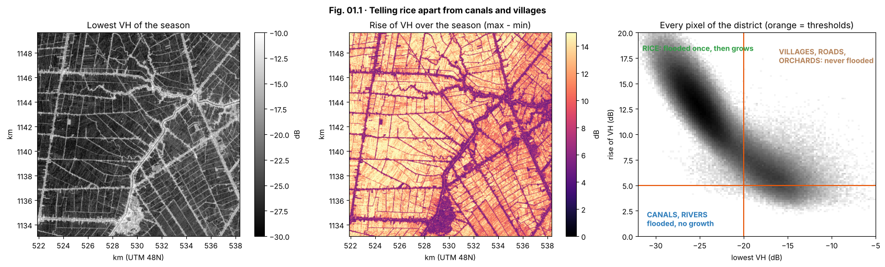
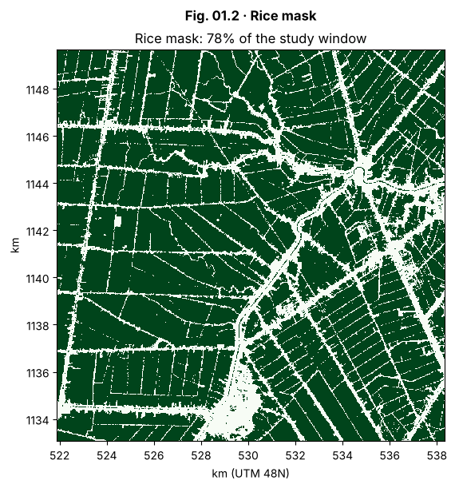
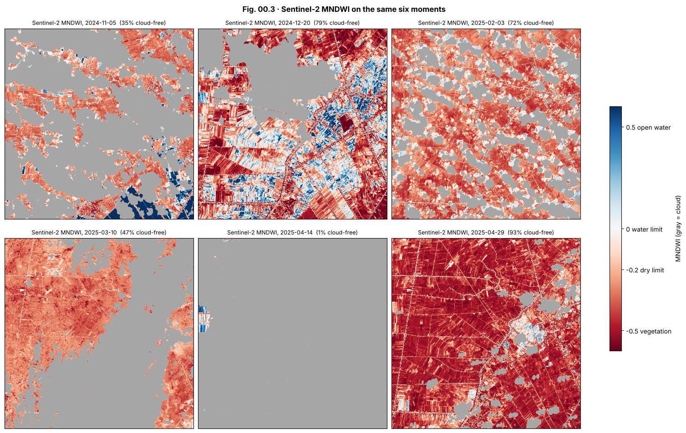
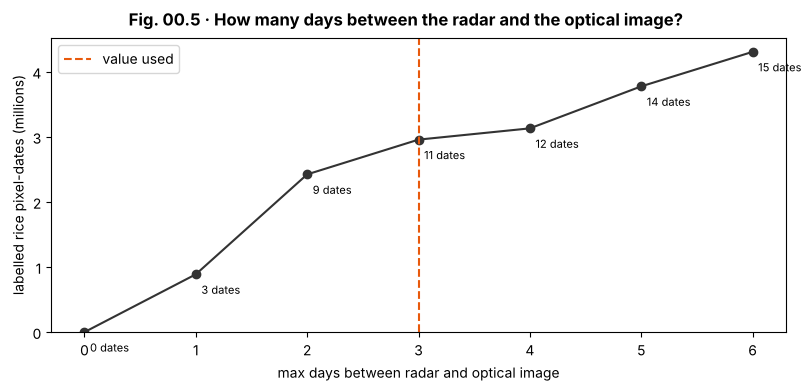
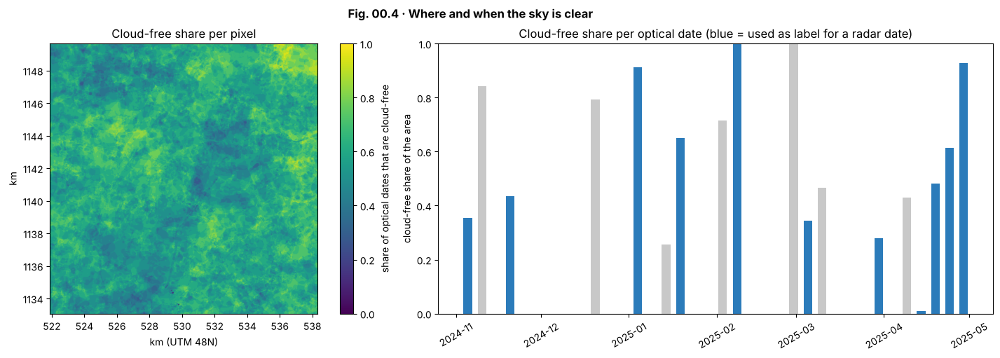
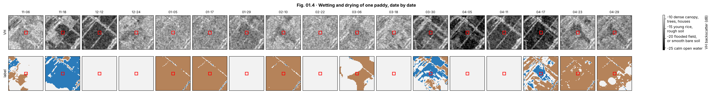
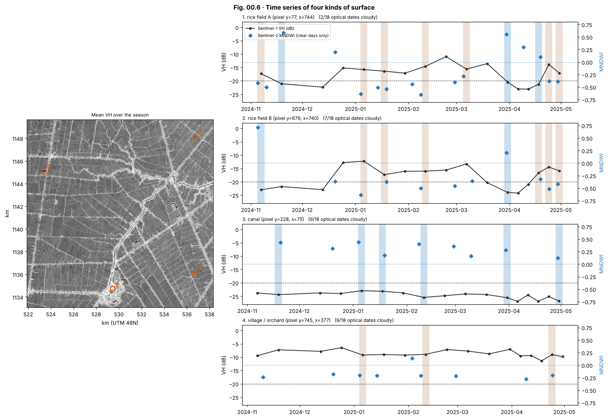
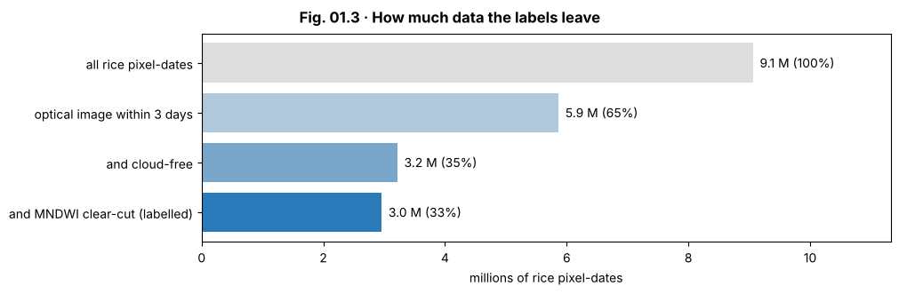
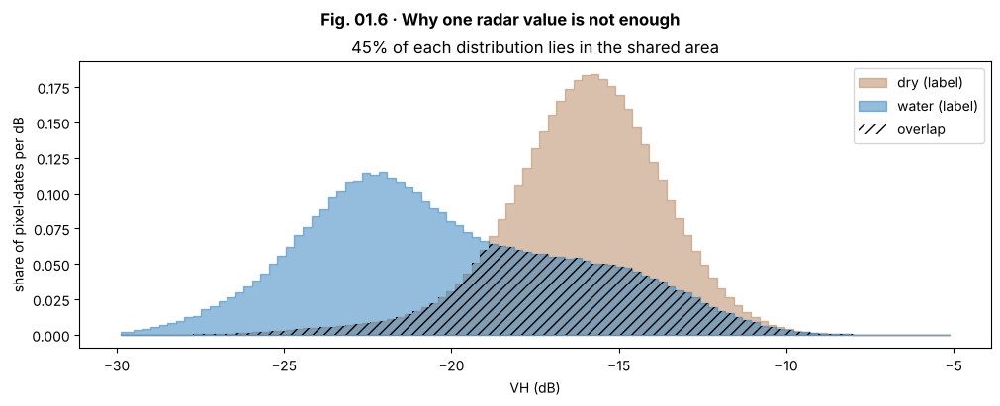
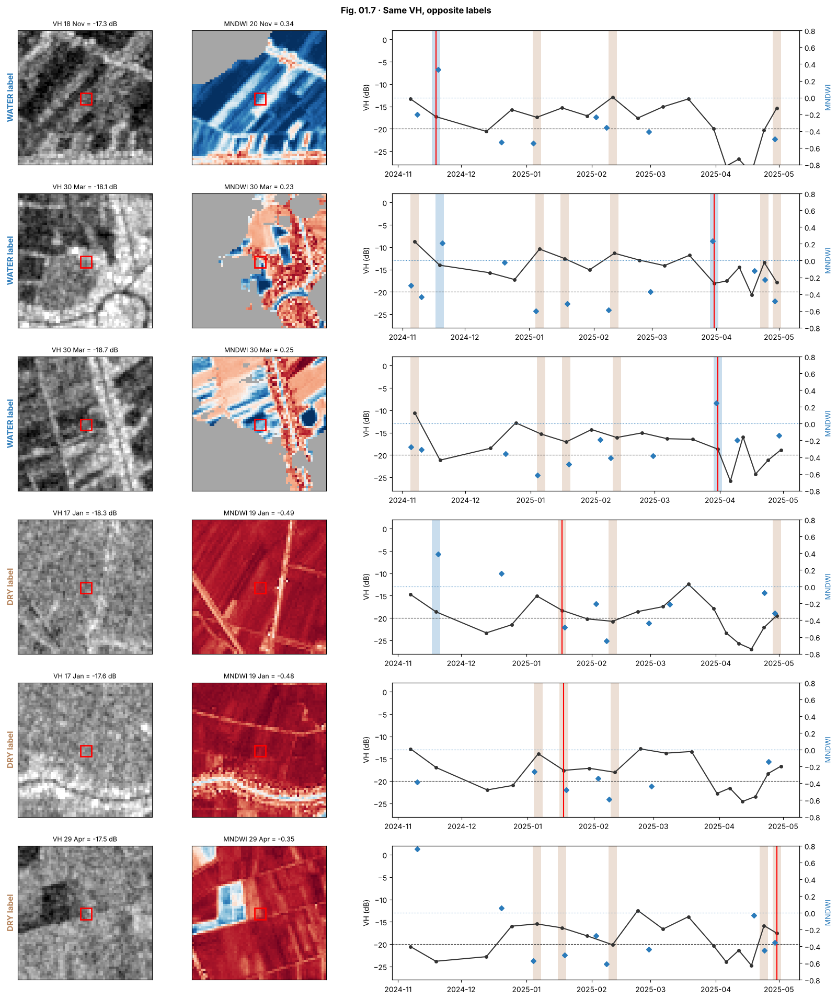

*Antoine Nasser - November 2026 - [code on GitHub](https://github.com/antoinenasser/sentinel-ricepaddy)*

**In short.**

My goal here was to explore how **satellite imagery** can help monitor sustainable irrigation practices at scale.

To distinguish flooded from non-flooded rice fields, I combine radar data from Sentinel-1 (C-band) with optical imagery from Sentinel-2. The study focuses on a rice-growing area in the Mekong Delta over a six-month period during the 2024–2025 winter-spring season. Sentinel-2 provides a reference for identifying open water through the Modified Normalized Difference Water Index (MNDWI), provided the sky is clear. This post explains how the dataset is built and where its limitations lie. Only about a third of rice pixel-dates can be labeled, and the radar signal (VH) alone is not sufficient to distinguish flooded from non-flooded fields.

---

## Introduction

Methane from human activities plays a major role in global warming: molecule for molecule, it has roughly 30 times the warming potential of carbon dioxide, and accounts for about 18% of human greenhouse gas emissions. Agriculture is the largest anthropogenic source, and flooded rice paddies contribute substantially to these emissions. In waterlogged, oxygen-deprived soils, microbes break down organic matter and release methane.

One irrigation practice promoted to reduce these emissions is to periodically let fields dry out during the growing season before flooding them again. This approach is known as Alternate Wetting and Drying (AWD). Verifying whether it is being implemented across thousands of small fields, without visiting each one, requires a way to monitor water levels at scale.

## Data

**Study area.** A window of about 16.5 × 16.5 km in the Thoai Son district, An Giang province, Mekong Delta (Vietnam), cut into 830 × 823 pixels of 20 m. The season studied is the **Winter-Spring crop**, from November 2024 to April 2025: the dry-season crop, when irrigation is managed and the sky is clearer than in the rainy season.

I follow the same idea that was used to build the Sen1Floods11 flood dataset [Bonafilia et al., 2020]: labeling radar images with optical ones.

**The input: Sentinel-1 radar.** Sentinel-1 sends microwave pulses (wavelength 5.6 cm, called *C-band*) and measures the share of energy that comes back to the satellite, the *backscatter*. It is expressed in decibels (dB), a logarithmic scale: −10 dB means a tenth of a reference level and −20 dB a hundredth, so the values are negative and lower means darker. The radar works day and night, through clouds. Calm water acts like a mirror and reflects the pulse away from the satellite, so a flooded field looks **dark**. A rough surface or a growing rice canopy scatters energy in all directions, part of it back to the satellite, and looks **brighter**.

The radar sends and receives the wave in two orientations (polarizations). **VH** (sent vertically, received horizontally) is mostly sensitive to vegetation and is the usual choice for rice [Nguyen et al., 2016; Bazzi et al., 2019]; this post shows only VH. All images come from a single orbit track, so every date is seen from the same angle. That gives 17 dates in 2024-25: one every 12 days (one pass, in late November, is missing), then one every 6 days from April 2025, when the Sentinel-1C satellite joined.

Radar images contain *speckle*, a grainy noise caused by the way waves add up within a pixel. Apart from the animation below, all figures and numbers use the images without any smoothing.

**The labels: Sentinel-2 optical images.** Sentinel-2 is a camera that also measures infrared light. Water absorbs short-wave infrared (SWIR) much more than green light, so the index MNDWI = (green − SWIR) / (green + SWIR) is positive over open water and strongly negative over soil and vegetation. Sentinel-2 passes about every 5 days, but it cannot see through clouds. Only the 18 images of the season with less than 60% cloud over the whole Sentinel-2 tile (about 110 km wide) were downloaded. Over our much smaller window, some of them are still almost fully cloudy (Fig. 6).

## Which pixels are rice?

To separate rice fields from canals, villages, orchards and roads, I use a simple rule based on the fact that VH varies a lot over the season in a rice paddy. A pixel is kept as rice if its lowest VH of the season is below −20 dB (it was **dark at least once**, as a flooded field is) and if the range of its VH over the season (highest minus lowest) is more than 5 dB (it **changes a lot**, as a field that is flooded and then grows does).

*Fig. 1. Left: lowest VH of the season per pixel. Middle: range of VH over the season. Right: every pixel in these two numbers, with the two thresholds (orange).*

*Fig. 2. The rice mask: 532,920 pixels, about 78% of the study window. Compare with a [satellite basemap of the same area](https://www.google.com/maps/@10.325,105.275,13z/data=!3m1!1e3).*

In Fig. 1 (right), the thresholds cut through a continuous cloud of points: many pixels have a large range but a lowest value between −20 and −15 dB. Some of them are probably rice fields whose flooding the radar did not see as dark enough. The mask therefore favors fields where the radar sees the water well.

## A season of rice, seen by Sentinel-1

<video src="assets/anim_vh_season.mp4" aria-label="A season of Sentinel-1 radar images over the district" class="img-fluid rounded z-depth-1 d-block mx-auto mb-2" controls autoplay loop muted playsinline></video>
*Fig. 3. The whole 2024-25 season seen by Sentinel-1 VH. Left: the study window; right: a 3 km zoom on single fields. Dark = smooth surface that sends the pulse away (open water, flooded field); bright = rough or vegetated surface (canopy, trees, houses). The bright lines are probably the houses and trees that line canals and roads; most canals are only one or two pixels wide, so their water is mixed with the banks. Bottom: median VH of rice pixels per radar date (black line; gray band = 25 to 75% of pixels; dashed line = −20 dB) and, on the right axis, the share of labeled rice pixels that Sentinel-2 sees as water (blue diamonds). The size of a diamond shows how many rice pixels have a label on that date: the small diamond of 11 April rests on less than 1% of them. The colored phases come from the usual Winter-Spring calendar of the region and from the curve, not from field observations; the last one is the start of the next crop (Summer-Autumn). Between passes, the images are cross-faded (only the held frames are real acquisitions), and for this animation only, a 3 × 3 pixel median filter reduces speckle.*

In the animation (Fig. 3), fields switch between dark and bright from one pass to the next, and neighboring fields do not switch on the same date. Averaged over all rice pixels of the window, the season follows a calendar:

- **Before sowing (early November)**, VH is relatively high, probably because of the stubble and soil left by the previous crop.
- **Flooding and sowing (mid-November to December).** On 18 November, 88% of the labeled rice pixels are water, while the radar median is still around −17 dB. The radar median reaches its lowest value, about −22 dB, on 12 December.
- **Canopy (January to mid-March).** The rice grows, and VH stays between about −17.5 and −14.5 dB.
- **Harvest (March)**, then **re-flooding** for the next crop in April, when VH drops again.

VH alone therefore cannot reliably distinguish a flooded field from one covered by a growing rice canopy. It is not sufficient to track the irrigation cycle of an individual field.

One explanation is the *double-bounce effect*: once rice plants are standing in water, part of the radar pulse can bounce off the water surface onto the stems and then back towards the satellite. As a result, a flooded field with standing rice can produce a signal as bright as that of a dry field.

In the following sections, I use MNDWI from Sentinel-2 optical imagery, which provides a more direct indication of open water. Unfortunately, it cannot see through clouds or detect water beneath a dense canopy.

## Matching radar and optical images

For each radar acquisition date, I select the closest Sentinel-2 image in time, provided it was acquired **no more than 3 days apart**. Each pixel in that optical image is then assigned one of three labels:

- **water** if MNDWI > 0;
- **no visible water** if MNDWI < −0.2. In the code and figures, this class is called "dry", but it means that the optical image sees no open water, not that the soil is dry;
- **no label** in between (mixed pixels, wet soil, field borders), and under clouds or cloud shadows (masked with the scene classification layer delivered with Sentinel-2).

*Fig. 4. MNDWI from the optical image closest to six radar dates spread over the season. Blue = water, red = vegetation or soil. Gray = cloud or cloud shadow (masked). Three of these images are more than 3 days from their radar date (20 Dec for 24 Dec, 3 Feb for 29 Jan, 10 Mar for 18 Mar): they are shown for comparison but give no label.*

**Why allow a 3-day difference?** The two satellites do not pass over the area at the same time. Here, Sentinel-1 passes at around 22:46 UTC, while Sentinel-2 passes at around 03:16 UTC. The closest pairs are therefore separated by 4.5 to 19.5 hours.

Acquisitions within a single day are relatively rare, and with only 17 radar dates covering an entire crop cycle, every labeled date matters. Allowing a 1-day difference provides labels for only 3 of the 17 radar dates; extending the window to 2 days gives 9 dates, and 3 days gives 11.

A wider time window therefore provides more labels, but at the cost of potentially less reliable matches: a field may be drained or flooded between the two satellite acquisitions. The current approach always selects the closest image in time, even if another image within the allowed window has less cloud cover. An alternative would be to select the clearest image within the window, an approach I have not tested.

*Fig. 5. Labeled rice pixel-dates as a function of the maximum time allowed between a radar date and its optical label (annotations: number of labeled radar dates). Orange: the value used.*

## Clouds and the calendar decide where and when labels exist

*Fig. 6. Left: share of the 18 optical dates on which each pixel is cloud-free. Right: cloud-free share of the window per optical date; blue bars are the images used as labels.*

Fig. 6 shows, for each pixel, how often the sky was clear (left), and the cloud-free share of the window on each optical date over the six months (right). Some periods have no usable optical image at all: none between 20 November and 20 December, for example, probably at the tail end of the rainy season. MNDWI therefore gives only a partial picture of the time series.

## What combining VH and MNDWI shows, and where it fails

Fig. 7 summarizes what we learn from matching the two satellites. It shows a 1.2 km window around one field, on every radar date. The field was picked automatically as the rice pixel with the most labels (at least 3 water and 3 no-water), at least 4 pixels inside the rice mask, so it is a favorable case. On several dates, MNDWI confirms as dry what VH suggests, so the radar could fill in such dates when the optical image is cloudy. On other dates, some areas look fairly bright in VH but are labeled as open water. In April, it is the opposite: dark patches in VH are labeled dry or have no label.

*Fig. 7. Top: VH. Bottom: label (blue water, brown no visible water, light gray none). The red square marks the field.*

The time series of other places (Fig. 8) show that flooding appears as a drop compared with the neighboring dates rather than as a fixed value, and that the canal stays dark while the village stays bright all season: what makes rice is the change over time. The village pixel also shows a limit of the labels: its MNDWI is slightly positive in early February (about +0.13), which gives it a "water" label. The MNDWI threshold is not error-free away from open water either.

*Fig. 8. Four kinds of surface, picked automatically by the notebook as typical examples of each kind. Left: mean VH over the season, with the four places. Right: VH on every pass (black, left axis), MNDWI on clear days (blue diamonds, right axis) and the label (shading: blue water, brown no visible water) for two rice fields, a canal and a village or orchard.*

## How much of the data can be labeled

*Fig. 9. From all rice pixel-dates to labeled ones. A pixel-date is one pixel on one radar date.*

In the end, only a third of the radar data can be labeled. Of the 9.1 million rice pixel-dates in the season (532,920 pixels × 17 dates), 65% have an optical image within 3 days, 35% also have a cloud-free pixel, and **33% get a label**: about 3 million pixel-dates, of which **13% are water** and 87% no visible water.

## Synthesis

We have built a simple framework for monitoring flooding in rice paddies using freely available satellite data (Sentinel-1 and Sentinel-2). Optical MNDWI measurements provide reference labels to help interpret whether a given radar VH signal corresponds to flooded or non-flooded conditions.

Radar imagery has the advantage of seeing through clouds, making it particularly useful for monitoring fields throughout the season. However, similar VH values can correspond to different surface conditions, as illustrated in Figs. 10 and 11. Combining additional satellite datasets with field observations or physical modeling could help resolve some of these ambiguities.

*Fig. 10. VH of all labeled water and no-water rice pixel-dates of the season (each curve has an area of 1). The hatched area is shared by both.*

*Fig. 11. Three water and three no-water pixel-dates with almost the same VH. Each row: the VH image, the MNDWI image (red square = the pixel and its 5 × 5 neighborhood) and the pixel's full time series (red line = the date shown).*

The limits of this dataset are summarized below.

1. **The optical labels are blind under the canopy.** From January to mid-March, MNDWI sees the leaves, not the water below, so a flooded field under rice is labeled "no visible water". The labels are therefore biased towards "no water" in the middle of the season, which is also when AWD drainage would happen.
2. **Optical labels can be offset by up to 3 days.** The closest available image is selected even when another image within the time window is clearer. A field may change its water status between the two acquisitions.
3. **Radar acquisitions are separated by 12 days** (and by 6 days from April 2025). A study in the Philippines and Japan, based on 406 water-level sensors across approximately 340 fields, found that short drainage events last a median of 19 hours, with most lasting less than 3 days [Jin et al., 2026]. Their radar instrument (PALSAR-2, L-band) and study region differ from ours, so this duration may not be representative of conditions in the Mekong Delta. Nevertheless, if drainage events are similarly short here, most would occur between two Sentinel-1 acquisitions and remain invisible to both the radar observations and the optical labels.
4. **The radar signals of the two classes overlap substantially (45% over the season).** This overlap has physical causes and may also reflect errors in the optical labels, although we cannot quantify the relative contributions of these effects.
5. **Two-thirds of rice pixel-dates have no label.** Moreover, missing labels are not randomly distributed: their availability depends on cloud cover, the timing of optical acquisitions, and the development of the rice canopy.
6. **The rice mask relies on a heuristic based on radar observations.** This selection criterion favors fields where radar clearly detects the water, potentially excluding other rice fields.
7. **One study area, one orbit, three seasons, and no ground truth.** None of the results has been validated against water levels measured in the field. The labels can therefore tell us whether radar observations agree with optical imagery, but not whether either sensor correctly captures the actual water status of a field

**What this means in practice.** A model trained on these labels will learn to reproduce the optical sensor's interpretation, including its blind spots. A high score indicates agreement with Sentinel-2 on clear-sky dates, which occur mostly at the beginning and end of the season. It does not demonstrate that the model correctly identifies water beneath the rice canopy.

This dataset can be used to test whether radar observations capture the major flooding and re-flooding events of a growing season. As it stands, however, it cannot validate the detection of mid-season drainage events, which is precisely what AWD verification would require. That would need independent field measurements of water levels, and probably more frequent observations.

Jin et al. [2026] reach a related conclusion for another radar instrument: using PALSAR-2 (L-band), they find substantial overlap between the signals of flooded and non-flooded fields and conclude that dual-polarization PALSAR-2 alone is unlikely to support robust field-scale monitoring of rice-field water status. Their study does not investigate Sentinel-1. Our observed 45% overlap is consistent with their findings, although it does not independently establish the same conclusion for Sentinel-1.

## Next: a neural network, and how to test it

In part 2, I train a small neural network that reads the whole season of each pixel [after Pelletier et al., 2019] and compare it with a threshold and a random forest. Pixels of one field share the same water, and pixels of one season share the same weather and calendar, so the way the data are split between training and test changes the score one reports. I compare several splits (random pixels, spatial blocks, a held-out season, held-out dates) and how far each one is from the score on a new season and new fields [Roberts et al., 2017].

## References

- Bazzi, H. et al. (2019). Mapping Paddy Rice Using Sentinel-1 SAR Time Series in Camargue, France. *Remote Sensing*, 11(7), 887. [doi:10.3390/rs11070887](https://doi.org/10.3390/rs11070887)
- Bonafilia, D., Tellman, B., Anderson, T., Issenberg, E. (2020). Sen1Floods11: a georeferenced dataset to train and test deep learning flood algorithms for Sentinel-1. *CVPR Workshops*.
- Jin, X. et al. (2026). Drainage Duration Variability and PALSAR-2 Sensitivity to Rice-Field Water Status: Insights from Large-Scale In Situ Water-Level Observations. *Remote Sensing*, 18(13), 2136. [doi:10.3390/rs18132136](https://doi.org/10.3390/rs18132136)
- Nguyen, D. B., Gruber, A., Wagner, W. (2016). Mapping rice extent and cropping scheme in the Mekong Delta using Sentinel-1A data. *Remote Sensing Letters*, 7(12), 1209–1218. [doi:10.1080/2150704X.2016.1225172](https://doi.org/10.1080/2150704X.2016.1225172)
- Pelletier, C., Webb, G. I., Petitjean, F. (2019). Temporal Convolutional Neural Network for the Classification of Satellite Image Time Series. *Remote Sensing*, 11(5), 523. [doi:10.3390/rs11050523](https://doi.org/10.3390/rs11050523)
- Roberts, D. R. et al. (2017). Cross-validation strategies for data with temporal, spatial, hierarchical, or phylogenetic structure. *Ecography*, 40(8), 913–929. [doi:10.1111/ecog.02881](https://doi.org/10.1111/ecog.02881)
- Tsyganskaya, V., Martinis, S., Marzahn, P., Ludwig, R. (2018). SAR-based detection of flooded vegetation: a review of characteristics and approaches. *International Journal of Remote Sensing*, 39(8), 2255–2293. [doi:10.1080/01431161.2017.1420938](https://doi.org/10.1080/01431161.2017.1420938)

*Data: Copernicus Sentinel-1 and Sentinel-2, accessed through Microsoft Planetary Computer. Figures are produced by `notebooks/00_data_tour.ipynb`, `notebooks/01_explore.ipynb` and `scripts/06_animation.py`. The code is developed with Claude. This post has been partially written with the help of Claude and ChatGPT.*
